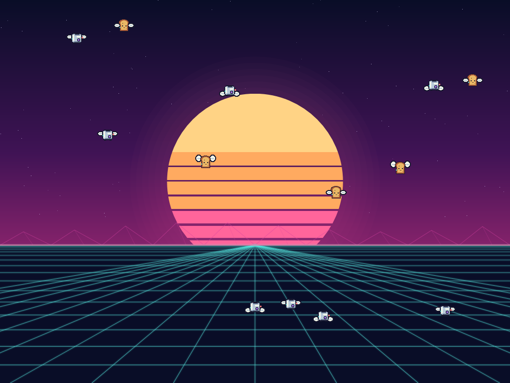

# Toaster Squadron

My personal, free Windows 11 screensaver: original chunky pixel-art winged toasters and toast drift diagonally across a neon sunset and scrolling perspective grid. C++20, Win32, Direct2D; no audio or external runtime to install.

**Early build — awaiting my Windows 11 PC test.** [The art brief](docs/ART-BRIEF.md) defines my sprite sheets and palette.



Screenshot from my running CI build on a GitHub-hosted Windows desktop, using the original placeholder art.

Toaster Squadron is an independent, original project and is not affiliated with or endorsed by Berkeley Systems or the makers of After Dark.

## Install and test

Open a green [GitHub Actions build](https://github.com/jerephil/toaster-squadron/actions/workflows/build.yml), download the `ToasterSquadron-windows-x64` artifact (GitHub sign-in required), and extract it. The extracted folder contains `ToasterSquadron.scr` at its top level, beside `assets/`, `docs/`, `README.md`, `LICENSE`, and `SHA256SUMS.txt`. From that folder, the exact Windows path is `.\ToasterSquadron.scr`; there is no `dist/` folder or second zip to open. Right-click it → **Install**, then use Windows Screen Saver Settings to preview and configure it. Alternatively copy it to `C:\Windows\System32` (administrator permission required). An unsigned download may trigger SmartScreen; inspect and build the source yourself if preferred.

- `ToasterSquadron.scr /s`: full screen on every monitor; exits on keyboard, click, or deliberate mouse movement.
- `ToasterSquadron.scr /p <HWND>`: live child preview for Windows Screen Saver Settings.
- `ToasterSquadron.scr /c` or no arguments: settings.

No version tag or Release will be created until I try the CI artifact on my Windows 11 PC and approve it.

## Settings

Flyers (5–40, default 15), slow/medium/fast speed, toast ratio (0–100%, default 30%), light/golden/dark toast, full synthwave/sun only/dark starfield, grid speed (off/slow/fast), and classic synthwave/sunset palette. Settings are per-user under `HKCU\Software\ToasterSquadron`.

## Build

Windows 11, Windows SDK, CMake 3.24+, and the Visual Studio 2022 C++ desktop toolchain:

```powershell
cmake -S . -B build -G "Visual Studio 17 2022" -A x64
cmake --build build --config Release
ctest --test-dir build -C Release --output-on-failure
```

The output is `build\Release\ToasterSquadron.scr`. Windows SDK libraries are the only application dependencies; Release uses the static MSVC runtime. CI uses public GitHub-hosted Windows runners only. If `windows-latest` has moved to a newer Visual Studio, the workflow installs the VS 2022 build tools from Microsoft before configuring.

## Validation

The Windows CI job builds with MSVC and exercises the settings dialog, live child preview and resizing, and full-screen monitor coverage with key/click/mouse exit and a mouse-jitter threshold. My [PC test checklist](docs/TESTING.md) covers appearance, mixed-DPI monitors, mouse jitter, and longer runs. The CI artifact is unsigned; it is not yet a published release.

## Art and license

I plan to have Claude Design create the final graphics using my [paste-ready art brief](docs/ART-BRIEF.md). The current original, code-generated sprites remain placeholders. The brief specifies four PNG sheets that drop into `assets/` without code changes. MIT licensed, copyright Jeremy W. Phillips; see [LICENSE](LICENSE).
